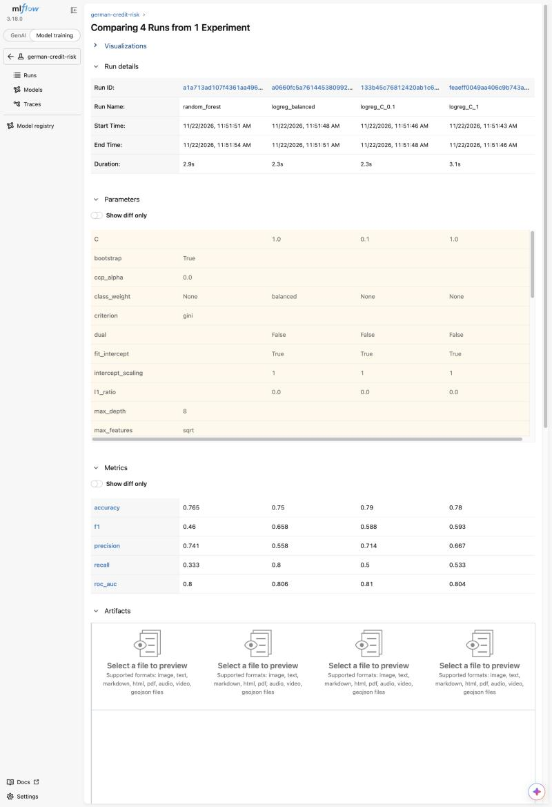
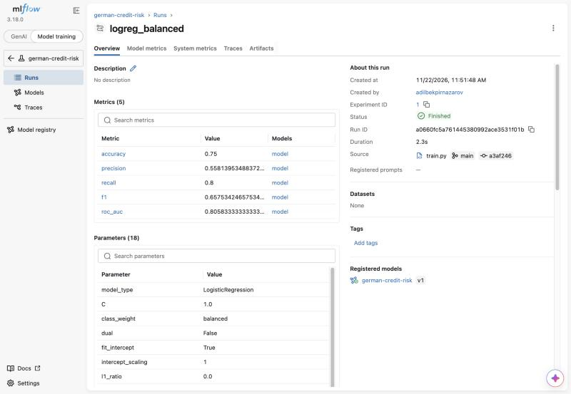
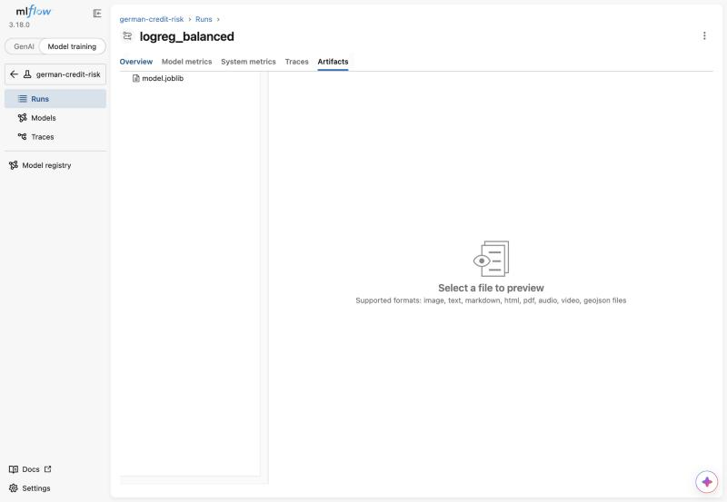
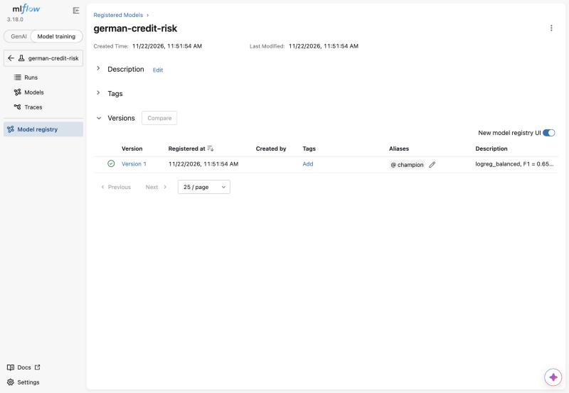
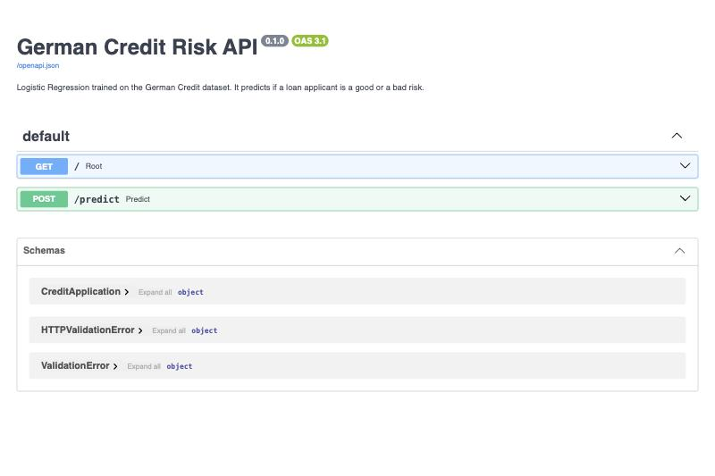
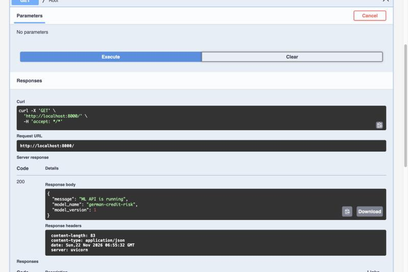
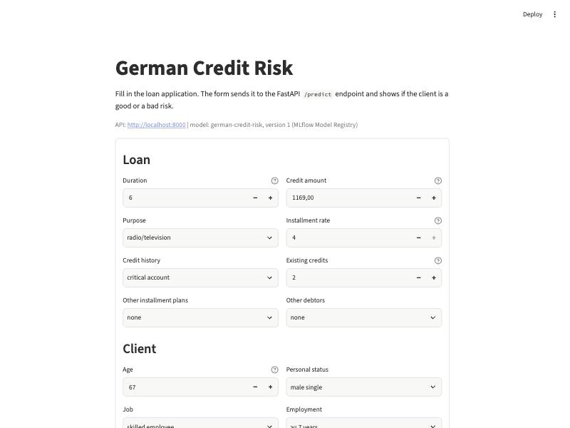
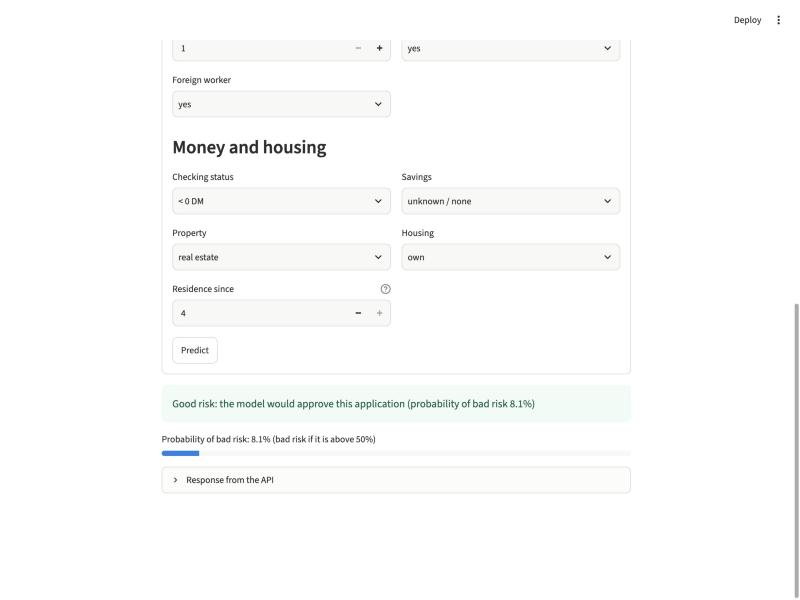
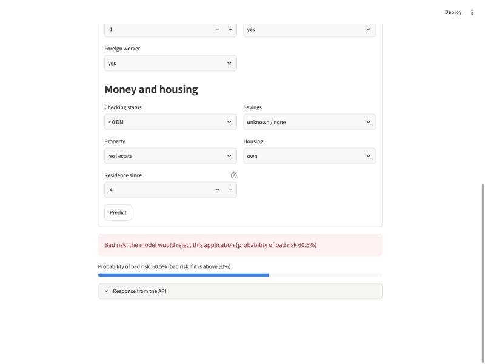

# German Credit Risk ML Service

A model that predicts if a loan applicant is a **good** or a **bad** risk, with an API, a Docker container, a web form and MLflow.

- **Practical Task 6:** train a model, serve it with FastAPI, run it in Docker.
- **SIS 3 (continuation of Practical Task 6):** Streamlit frontend + MLflow experiment tracking and Model Registry.

The version that was handed in for Practical Task 6 is saved in the git tag `practice-6`.

## How it works

```
train.py ──> MLflow (4 runs: params, metrics, artifacts)
   │            └─> Model Registry: german-credit-risk, version 1, alias "champion"
   │
   └─> model.joblib + model_info.json (the champion model)
              │
              ▼
        main.py (FastAPI in Docker, port 8000)  <──  app.py (Streamlit form, port 8501)
```

## Project structure

```
german-credit-ml-service/
├── train.py                # trains 4 models, logs them to MLflow, registers the best one
├── main.py                 # FastAPI app (GET /, POST /predict)
├── app.py                  # Streamlit frontend, sends the form to the API
├── model.joblib            # the champion model (the whole sklearn pipeline)
├── model_info.json         # name and version of the model in the MLflow Model Registry
├── german.data             # German Credit dataset (UCI)
├── requirements.txt        # dependencies of the API (used in Docker)
├── requirements-local.txt  # + MLflow and Streamlit, for training and the frontend
├── Dockerfile              # container for the API
├── screenshots/            # screenshots of the tests
└── README.md
```

`mlflow.db` and `mlruns/` are not in git, they are created by `train.py`.

## 1. Training and MLflow (SIS 3)

**Dataset:** [Statlog German Credit Data](https://archive.ics.uci.edu/dataset/144/statlog+german+credit+data) from UCI, the same data as in Practice 3 and 5. 1000 clients, 20 features, 30% of the clients are bad risk.

- The target is changed to **0 = good risk** and **1 = bad risk** (bad risk is the positive class).
- The codes from the dataset (A11, A34, ...) are changed to readable values, for example `A11 -> "< 0 DM"`, so the API can accept normal text.
- Train/test split 80/20 with `stratify`, `random_state=42`.
- Preprocessing: OneHotEncoder for 13 categorical features + StandardScaler for 7 numeric features. The whole pipeline is saved, so the API gets raw values.

### Experiment tracking

`train.py` creates the MLflow experiment **german-credit-risk** and trains 4 models. Each model is one run:

| Run | Model |
|---|---|
| `logreg_C_1` | Logistic Regression, the model from Practice 3 and Practice 6 |
| `logreg_C_0.1` | Logistic Regression with stronger regularization |
| `logreg_balanced` | Logistic Regression with `class_weight="balanced"` |
| `random_forest` | Random Forest, 200 trees, `max_depth=8` |

For every run MLflow logs:

- **parameters:** model type, all hyperparameters of the model (`C`, `class_weight`, `max_depth`, ...), and the split settings
- **metrics** on the test set: accuracy, precision, recall, F1, ROC-AUC
- **artifacts:** `model.joblib` (the same file the API uses) and the model in MLflow format (`mlflow.sklearn.log_model`)

Output of `python train.py`:

```
                 accuracy  precision  recall     f1  roc_auc
run
logreg_C_1          0.780      0.667   0.533  0.593    0.804
logreg_C_0.1        0.790      0.714   0.500  0.588    0.810
logreg_balanced     0.750      0.558   0.800  0.658    0.806
random_forest       0.765      0.741   0.333  0.460    0.800
Best run: logreg_balanced (F1 = 0.658)
Registered as 'german-credit-risk' version 1, alias 'champion'
```

- `logreg_C_0.1` has the best accuracy (0.790) and ROC-AUC (0.810), but it finds only half of the bad clients (recall 0.500).
- `random_forest` has the highest precision (0.741), but the lowest recall (0.333).
- `logreg_balanced` has the best F1 (0.658) and recall (0.800): it finds 48 of 60 bad clients, the Practice 6 model found only 32. The price is accuracy 0.750 and more good clients rejected (38 instead of 16).

In Practice 3 we said that approving a bad client is about 5 times more expensive than rejecting a good one. With this cost (5·FN + FP) `logreg_C_1` has 5·28 + 16 = 156 and `logreg_balanced` has 5·12 + 38 = 98, so the balanced model is better for the bank.

### Model Registry

The run with the best F1 is registered in the MLflow Model Registry:

- **name:** `german-credit-risk`
- **version:** 1
- **alias:** `champion`
- **description:** `logreg_balanced, F1 = 0.658 on the test set`

The champion is also saved to `model.joblib`, and `model_info.json` keeps its name and version, so the API knows which model from the registry it serves. If `train.py` is run again, MLflow adds new runs and a new version (2, 3, ...), and the alias `champion` moves to the newest best model.

### Open the MLflow UI

```bash
mlflow ui --backend-store-uri sqlite:///mlflow.db --port 5001
```

Then open http://localhost:5001 (port 5000 is often used by AirPlay on macOS).

Comparison of the 4 runs (parameters and metrics):



The champion run with its metrics, parameters and the registered model version:



Artifacts of the run (`model.joblib`):



Model Registry: `german-credit-risk`, version 1, alias `champion`:



## 2. FastAPI app (Practical Task 6)

The model is loaded one time when the app starts (`joblib.load("model.joblib")`) and is used in every `/predict` request.

| Method | Endpoint | What it does |
|---|---|---|
| GET | `/` | returns `{"message": "ML API is running"}` and the model name and version |
| POST | `/predict` | gets the features of one client and returns the prediction |
| GET | `/docs` | Swagger UI (made by FastAPI automatically) |

The input is checked with Pydantic. Categorical features accept only the values from the dataset (for example `housing` is `"rent"`, `"own"` or `"for free"`), and numeric features have simple limits (`age >= 18`, `installment_rate` from 1 to 4). A wrong value returns error **422**. All allowed values can be seen in `/docs` (section Schemas -> CreditApplication).

Example request (the second client from the dataset, a real bad client):

```json
{
  "checking_status": "0-200 DM",
  "duration": 48,
  "credit_history": "existing paid back till now",
  "purpose": "radio/television",
  "credit_amount": 5951,
  "savings": "< 100 DM",
  "employment": "1-4 years",
  "installment_rate": 2,
  "personal_status": "female divorced/separated/married",
  "other_debtors": "none",
  "residence_since": 2,
  "property": "real estate",
  "age": 22,
  "other_installment_plans": "none",
  "housing": "own",
  "existing_credits": 1,
  "job": "skilled employee",
  "people_liable": 1,
  "telephone": "none",
  "foreign_worker": "yes"
}
```

Response:

```json
{"prediction": 1, "risk": "bad", "probability_bad": 0.739}
```

- `prediction` - 0 (good risk) or 1 (bad risk), threshold 0.5
- `risk` - the same in words
- `probability_bad` - probability of bad risk, so the bank can also use its own threshold

### Run locally

```bash
python3 -m venv .venv
source .venv/bin/activate
pip install -r requirements-local.txt

python train.py
uvicorn main:app --reload
```

Then open http://localhost:8000/ and http://localhost:8000/docs. In Swagger `/predict` can be tested with **Try it out -> Execute** (there is a ready example in the request body).

## 3. Docker (Practical Task 6)

The `Dockerfile` uses the `python:3.12-slim` image, sets `/app` as working directory, installs `requirements.txt`, copies the project and runs the app with Uvicorn on port 8000. The versions in `requirements.txt` are fixed, because `model.joblib` has to be loaded with the same scikit-learn version that was used for training. MLflow and Streamlit are not installed in the container, the API needs only `model.joblib` and `model_info.json`.

Build the image:

```bash
docker build -t german-credit-api .
```

On macOS the build can fail with `docker-credential-desktop: executable file not found in $PATH`. It means that the Docker Desktop tools are not in PATH, this fixes it for the current terminal:

```bash
export PATH="/Applications/Docker.app/Contents/Resources/bin:$PATH"
```

Run the container:

```bash
docker run -d --name german-credit-api -p 8000:8000 german-credit-api
```

Check that it is running:

```bash
docker ps
```

```
IMAGE               STATUS        PORTS                                         NAMES
german-credit-api   Up 1 second   0.0.0.0:8000->8000/tcp, [::]:8000->8000/tcp   german-credit-api
```

Test the endpoints:

```bash
curl http://localhost:8000/
```

```bash
curl -X POST http://localhost:8000/predict -H "Content-Type: application/json" -d '{"checking_status": "0-200 DM", "duration": 48, "credit_history": "existing paid back till now", "purpose": "radio/television", "credit_amount": 5951, "savings": "< 100 DM", "employment": "1-4 years", "installment_rate": 2, "personal_status": "female divorced/separated/married", "other_debtors": "none", "residence_since": 2, "property": "real estate", "age": 22, "other_installment_plans": "none", "housing": "own", "existing_credits": 1, "job": "skilled employee", "people_liable": 1, "telephone": "none", "foreign_worker": "yes"}'
```

Stop and remove the container:

```bash
docker stop german-credit-api
docker rm german-credit-api
```

After a new `python train.py` the image has to be built again, so the container gets the new `model.joblib`.

### Results in the container

The build finished without errors, and the container gives the same results as the local run:

| Test | Result |
|---|---|
| `GET /` | `{"message": "ML API is running", "model_name": "german-credit-risk", "model_version": 1}` |
| `GET /docs` | 200, Swagger UI opens |
| `POST /predict`, client 1 (real: good) | `{"prediction": 0, "risk": "good", "probability_bad": 0.081}` |
| `POST /predict`, client 2 (real: bad) | `{"prediction": 1, "risk": "bad", "probability_bad": 0.739}` |
| `POST /predict` with `housing: "castle"`, `age: 10` | 422, errors for `housing` and `age` |

Swagger UI from the container:



`GET /`:



`POST /predict` with the example client:


## 4. Streamlit frontend (SIS 3)

`app.py` is a simple web form for the loan application. It does not load the model itself, it only talks to the API:

1. `GET /` - checks that the API is running and shows the model name and version from the registry.
2. `GET /openapi.json` - takes the allowed values for every dropdown from the API schema, so the form always has the same values as `main.py`.
3. `POST /predict` - sends the filled form and shows the result: good or bad risk and the probability of bad risk.

The fields are split into 3 groups: Loan, Client, Money and housing. The first client from the dataset is filled in by default.

Run it (the API must be running locally or in Docker):

```bash
streamlit run app.py
```

Then open http://localhost:8501. The address of the API can be changed with the `API_URL` environment variable (default `http://localhost:8000`).

The form (the API runs in the Docker container):



The default client: good risk, probability of bad risk 8.1%:



The same client, but with a loan for 48 months, 8000 DM and credit history "existing paid back till now": bad risk, 60.5%:



## Run the whole system

```bash
pip install -r requirements-local.txt
python train.py                                                # MLflow runs + registry + model.joblib
docker build -t german-credit-api .                            # API image with the champion model
docker run -d --name german-credit-api -p 8000:8000 german-credit-api
streamlit run app.py                                           # frontend on http://localhost:8501
mlflow ui --backend-store-uri sqlite:///mlflow.db --port 5001  # MLflow on http://localhost:5001
```
