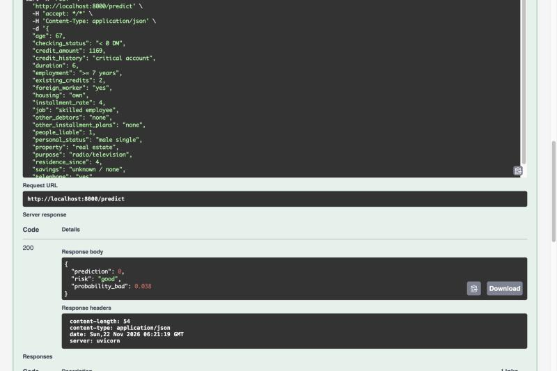

# German Credit Risk API

Practical Task 6. Deploy ML Model with FastAPI and Docker.

A Logistic Regression model predicts if a loan applicant is a **good** or a **bad** risk. The model is served with FastAPI and runs inside a Docker container.

## Project structure

```
german-credit-ml-service/
├── train.py           # trains the model and saves model.joblib
├── main.py            # FastAPI app
├── model.joblib       # saved model (the whole sklearn pipeline)
├── german.data        # German Credit dataset (UCI)
├── requirements.txt   # Python dependencies
├── Dockerfile         # container instructions
├── screenshots/       # screenshots of the tests
└── README.md
```

## Step 1. Model

**Dataset:** [Statlog German Credit Data](https://archive.ics.uci.edu/dataset/144/statlog+german+credit+data) from UCI, the same data as in Practice 3 and 5. 1000 clients, 20 features, 30% of the clients are bad risk.

- The target is changed to **0 = good risk** and **1 = bad risk** (bad risk is the positive class).
- The codes from the dataset (A11, A34, ...) are changed to readable values, for example `A11 -> "< 0 DM"`, so the API can accept normal text.
- Train/test split 80/20 with `stratify`, `random_state=42`.
- Pipeline: OneHotEncoder for 13 categorical features + StandardScaler for 7 numeric features + `LogisticRegression(max_iter=1000)`.
- The whole pipeline is saved to `model.joblib`, so the API gets raw values and the same preprocessing is done inside the model.

Output of `python train.py`:

```
             pred good  pred bad
actual good        124        16
actual bad          28        32

Accuracy:  0.78
Precision: 0.667
Recall:    0.533
F1:        0.593

Model saved to model.joblib
```

The result is the same as the best model in Practice 3.

## Step 2. FastAPI app

The model is loaded one time when the app starts (`joblib.load("model.joblib")`) and is used in every `/predict` request.

| Method | Endpoint | What it does |
|---|---|---|
| GET | `/` | returns `{"message": "ML API is running"}` |
| POST | `/predict` | gets the features of one client and returns the prediction |
| GET | `/docs` | Swagger UI (made by FastAPI automatically) |

The input is checked with Pydantic. Categorical features accept only the values from the dataset (for example `housing` is `"rent"`, `"own"` or `"for free"`), and numeric features have simple limits (`age >= 18`, `installment_rate` from 1 to 4). A wrong value returns error **422**. All allowed values can be seen in `/docs` (section Schemas -> CreditApplication).

Example request (the second client from the dataset, a real bad client):

```json
{
  "checking_status": "0-200 DM",
  "duration": 48,
  "credit_history": "existing paid back till now",
  "purpose": "radio/television",
  "credit_amount": 5951,
  "savings": "< 100 DM",
  "employment": "1-4 years",
  "installment_rate": 2,
  "personal_status": "female divorced/separated/married",
  "other_debtors": "none",
  "residence_since": 2,
  "property": "real estate",
  "age": 22,
  "other_installment_plans": "none",
  "housing": "own",
  "existing_credits": 1,
  "job": "skilled employee",
  "people_liable": 1,
  "telephone": "none",
  "foreign_worker": "yes"
}
```

Response:

```json
{"prediction": 1, "risk": "bad", "probability_bad": 0.559}
```

- `prediction` - 0 (good risk) or 1 (bad risk), threshold 0.5
- `risk` - the same in words
- `probability_bad` - probability of bad risk, so the bank can also use its own threshold

## Step 3. Run locally

```bash
python3 -m venv .venv
source .venv/bin/activate
pip install -r requirements.txt

python train.py
uvicorn main:app --reload
```

Then open:

- http://localhost:8000/ - root endpoint
- http://localhost:8000/docs - Swagger UI, `/predict` can be tested with **Try it out -> Execute** (there is a ready example in the request body)

Tested locally with Uvicorn: `/` returns the message, `/docs` opens, and `/predict` returns `good` (0.038) for the first client and `bad` (0.559) for the second one.

## Steps 4-6. Docker

The `Dockerfile` uses the `python:3.12-slim` image, sets `/app` as working directory, installs `requirements.txt`, copies the project and runs the app with Uvicorn on port 8000. The versions in `requirements.txt` are fixed, because `model.joblib` has to be loaded with the same scikit-learn version that was used for training.

Build the image:

```bash
docker build -t german-credit-api .
```

Run the container:

```bash
docker run -d --name german-credit-api -p 8000:8000 german-credit-api
```

Check that it is running:

```bash
docker ps
```

```
IMAGE               STATUS        PORTS                                         NAMES
german-credit-api   Up 1 second   0.0.0.0:8000->8000/tcp, [::]:8000->8000/tcp   german-credit-api
```

Test the endpoints:

```bash
curl http://localhost:8000/
```

```bash
curl -X POST http://localhost:8000/predict -H "Content-Type: application/json" -d '{"checking_status": "0-200 DM", "duration": 48, "credit_history": "existing paid back till now", "purpose": "radio/television", "credit_amount": 5951, "savings": "< 100 DM", "employment": "1-4 years", "installment_rate": 2, "personal_status": "female divorced/separated/married", "other_debtors": "none", "residence_since": 2, "property": "real estate", "age": 22, "other_installment_plans": "none", "housing": "own", "existing_credits": 1, "job": "skilled employee", "people_liable": 1, "telephone": "none", "foreign_worker": "yes"}'
```

Stop and remove the container:

```bash
docker stop german-credit-api
docker rm german-credit-api
```

### Results in the container

The build finished without errors, and the container gives the same results as the local run:

| Test | Result |
|---|---|
| `GET /` | `{"message": "ML API is running"}` |
| `GET /docs` | 200, Swagger UI opens |
| `POST /predict`, client 1 (real: good) | `{"prediction": 0, "risk": "good", "probability_bad": 0.038}` |
| `POST /predict`, client 2 (real: bad) | `{"prediction": 1, "risk": "bad", "probability_bad": 0.559}` |
| `POST /predict` with `housing: "castle"`, `age: 10` | 422, errors for `housing` and `age` |

Swagger UI from the container:


`GET /`:


`POST /predict` with the example client:


